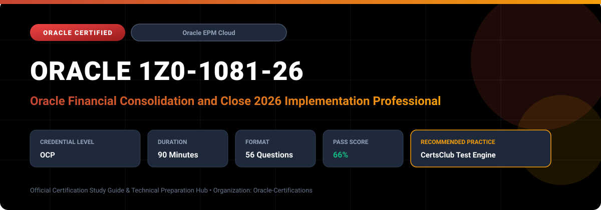

  

# Oracle 1Z0-1081-26: Oracle Financial Consolidation and Close 2026 Implementation Professional

---

## 1. Exam Overview & Candidate Profile

The **Oracle 1Z0-1081-26: Oracle Financial Consolidation and Close 2026 Implementation Professional** examination is engineered for enterprise architects, solution specialists, functional consultants, and implementation professionals seeking formal industry recognition of their proficiency in Oracle technologies.

The Oracle Financial Consolidation and Close 2026 Implementation Professional (1Z0-1081-26) certification confirms candidate expertise in designing and deploying enterprise-grade financial close and statutory consolidation solutions using Oracle FCCS Cloud. It validates skills in complex multi-currency translation, statutory reporting, partnership accounting, and automated close compliance.

### Target Audience & Prerequisites
- **Target Roles**: Implementation Specialists, Cloud Architects, Technical Leads, Enterprise Functional Consultants, and Systems Engineers.
- **Recommended Experience**: 1–2 years of practical, hands-on experience designing, implementing, and maintaining corresponding Oracle Cloud solutions.
- **Credential Earned**: Oracle Certified Professional (OCP).

---

## 2. Key Exam Specifications

| Specification | Details |
| :--- | :--- |
| **Exam Code** | **Oracle 1Z0-1081-26** |
| **Official Title** | Oracle Financial Consolidation and Close 2026 Implementation Professional |
| **Certification Track** | Oracle Enterprise Performance Management Cloud |
| **Exam Duration** | 90 Minutes |
| **Number of Questions** | 56 Questions |
| **Passing Score** | 66% |
| **Question Format** | Multiple Choice (Single/Multiple Answer), Scenario-Based Questions |
| **Delivery Provider** | Oracle University / Pearson VUE (Online Proctored or Test Center) |
| **Recommended Practice Engine** | [CertsClub Oracle Practice Tests](https://www.certsclub.com/oracle/1z0-1081-26-dumps.html) |

---

## 3. Official Blueprint & Exam Domain Breakdown

The examination assesses candidate competencies across core functional domains weighted as follows:

| Domain Area | Weighting |
| :--- | :--- |
| **FCCS Application Setup, Dimensions & Architecture** | `25%` |
| **Consolidation Process, Rules & Multi-GAAP Setup** | `25%` |
| **Intercompany Eliminations & Ownership Management** | `20%` |
| **Currency Translation & Equity Adjustments** | `15%` |
| **Close Manager, Supplemental Data & Task Management** | `15%` |

---

## 4. Deep Dive into Complex & Challenging Technical Topics

To secure a passing score on the 1Z0-1081-26 exam, candidates must master the following advanced concepts:

- Ownership Management setup, subsidiary consolidation methods (Holding, Subsidiary, Proportional, Equity).
- Configuring CTA (Cumulative Translation Adjustment) accounts, historical currency rates, and average vs. closing translation logic.
- Designing Configurable Consolidation Rules (CCR) with rule sets inserted at specific calculation phases.
- Managing audit trails, journal entries with approvals, and integrating General Ledger sources through Data Management.

---

## 5. Scenario-Based Demo & Practice Questions

### Question 1
When an entity's ownership percentage changes mid-year from 60% to 80%, how does FCCS handle the ownership calculation and consolidation adjustments?

A) By updating the Ownership Management table and executing a consolidation for the impacted periods.
B) By deleting the historical entity and creating a replacement entity.
C) By manually posting reversing journal entries in General Ledger.
D) By re-initializing the entire FCCS application.

- **Correct Answer**: `A) By updating the Ownership Management table and executing a consolidation for the impacted periods.`  
- **Technical Explanation**: Ownership Management allows administrators to record tiered ownership percentages and consolidation methods by period; running consolidation then applies the updated ownership proportions and non-controlling interest calculations.

---

### Question 2
Which feature in FCCS enables collection of granular footnote details, transactional disclosures, and non-financial data without adding custom dimensions to the main consolidation cube?

A) Supplemental Data Manager (SDM)
B) Secondary Cost Books
C) Sourcing Rule Tables
D) Data Silo Forms

- **Correct Answer**: `A) Supplemental Data Manager (SDM)`  
- **Technical Explanation**: Supplemental Data Manager allows organizations to gather detailed sub-ledger, disclosure, and footnote data via structured collection forms without bloating the primary consolidation dimensional model.

---

## 6. Recommended Preparation Strategy & Practice Testing Engine

Achieving certification in **Oracle 1Z0-1081-26** requires balanced theoretical study and scenario-based simulation practice:

1. **Review Oracle Documentation**: Master architecture guides, implementation workbooks, and administration manuals on the Oracle Help Center.
2. **Hands-on Lab Practice**: Execute real-world configuration, policy setup, and troubleshooting tasks in your cloud tenancy or test instance.
3. **Simulated Exam Drills**: Practice answering timed, scenario-based multiple-choice questions to familiarize yourself with the question formats, traps, and timing constraints.

### Practice With CertsClub
For realistic practice questions, updated dumps, and mock testing environments:
- **Resource**: [CertsClub Oracle Practice Test Engine](https://www.certsclub.com/oracle/1z0-1081-26-dumps.html)
- **Special Discount**: Use coupon code **`club20`** during checkout for an instant **20% discount** on all practice exam bundles and testing engines.

---

## 7. Official Documentation & References

- [Oracle University Certification Registry](https://education.oracle.com/)
- [Oracle Help Center Documentation Portal](https://docs.oracle.com/)
- [Oracle Cloud Infrastructure & Applications Guides](https://docs.oracle.com/en/cloud/)
- [CertsClub Oracle Certification Exam Practice](https://www.certsclub.com/oracle/1z0-1081-26-dumps.html)

---

## 8. SEO & Discovery Keywords

`oracle 1z0-1081-26, oracle 1z0-1081-26 exam, oracle 1z0-1081-26 dumps, 1Z0-1081-26 practice questions, 1Z0-1081-26 study guide, oracle 1z0-1081-26 syllabus, oracle financial consolidation and close 2026 implementation professional, certsclub 1z0-1081-26`
